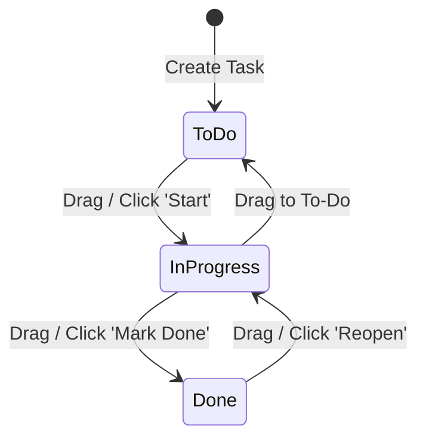

# TaskFlow — Mini Kanban Task Management Application

Production-quality full-stack Kanban task management application developed for the **Aarvion Services India Pvt. Ltd. MERN Stack Developer Assessment**.

TaskFlow is built as a clean monorepo containing a modular **Node.js/Express/MongoDB** REST API backend and a responsive **React/TypeScript/Vite** frontend with tactile Bento Grid aesthetics, full light/dark theme support, drag-and-drop Kanban workflow, and installable Progressive Web App (PWA) capabilities.

---

## Table of Contents

1. [Project Overview & Key Features](#project-overview--key-features)
2. [Technology Stack](#technology-stack)
3. [Monorepo Architecture](#monorepo-architecture)
4. [Prerequisites](#prerequisites)
5. [Local Environment Setup](#local-environment-setup)
   - [Backend Configuration](#1-backend-setup)
   - [Frontend Configuration](#2-frontend-setup)
6. [Environment Variables](#environment-variables)
7. [REST API Documentation](#rest-api-documentation)
   - [Health Check](#health-check)
   - [Authentication Endpoints](#authentication-endpoints)
   - [Task Management Endpoints](#task-management-endpoints)
   - [Standard Error Responses & Status Codes](#standard-error-responses--status-codes)
8. [Task Status Workflow](#task-status-workflow)
9. [Verification & Build Commands](#verification--build-commands)
10. [Security & Architectural Design](#security--architectural-design)
11. [PWA & Offline Shell Caching Policy](#pwa--offline-shell-caching-policy)
12. [Known Limitations & Deployment Notes](#known-limitations--deployment-notes)
13. [Assessment Submission Checklist](#assessment-submission-checklist)

---

## Project Overview & Key Features

- **Authentication & Authorization:** Secure user registration and login using `bcryptjs` password hashing (salt rounds: 10) and stateless JSON Web Tokens (JWT) verified on all task endpoints.
- **Strict Per-User Data Isolation:** Every database query filters by the authenticated user's ID (`req.userId` extracted from the verified JWT). Client-supplied owner IDs are rejected to prevent IDOR vulnerabilities.
- **Visual Kanban Board:** Three distinct status columns—**To-Do**, **In-Progress**, and **Done**—with task counts, empty states, and tactile sticky-note cards.
- **Drag-and-Drop Interaction:** Powered by `@dnd-kit` with mouse, touch, and keyboard sensors. Includes optimistic UI updates with automatic rollback to previous column if the status update API request fails.
- **Complete Task CRUD:** Create new tasks, edit titles and descriptions in an accessible modal dialog, delete tasks with confirmation, and perform quick status transitions.
- **Responsive & Accessible Design:** Tactile Bento Grid layout on desktop with an intuitive segmented column selector tab bar on mobile devices. Uses semantic HTML and ARIA labels.
- **Dual Theme Support:** Fully designed Light and Dark modes with persistent user preference storage.
- **Installable PWA Support:** Web App Manifest with desktop and mobile icons (including maskable icon) and a native Service Worker precaching the static application shell.
- **Rate Limiting & Security:** Authentication endpoints are rate-limited (20 requests per 15 minutes) with HTTP 429 JSON responses; HTTP security headers enabled via `helmet`; request body size restricted to 10kb; malformed JSON and MongoDB ObjectIDs validated safely.

---

## Technology Stack

### Backend (`/server`)
- **Runtime:** Node.js (ES Modules, `type: "module"`)
- **Web Framework:** Express.js (`^5.3.0`)
- **Database & ODM:** MongoDB via Mongoose (`^9.11.2`)
- **Authentication:** `jsonwebtoken` (`^9.0.3`) & `bcryptjs` (`^3.0.3`)
- **Validation:** `express-validator` (`^7.3.2`)
- **Security:** `helmet` (`^8.3.0`), `cors` (`^2.8.6`), `express-rate-limit` (`^8.7.1`)
- **Testing:** Node.js built-in test runner (`node --test`)

### Frontend (`/client`)
- **Framework & Tooling:** React (`^19.2.8`), TypeScript (`^7.0.2`), Vite (`^8.3.0`)
- **Routing:** React Router (`^7.18.4`)
- **Drag-and-Drop:** `@dnd-kit/core`, `@dnd-kit/sortable`, `@dnd-kit/utilities`
- **Styling:** Vanilla CSS Modules with custom design tokens
- **Linter & Formatter:** Oxlint (`^1.81.0`)
- **PWA:** Native Service Worker with static cache precaching and Web App Manifest

---

## Monorepo Architecture

```
TaskFlow/
├── .agents/                    # Engineering rules and launch standards
├── .gitignore                  # Monorepo-level git ignore rules (.env, node_modules, dist)
├── package.json                # Monorepo root scripts & dev orchestration (concurrently)
├── README.md                   # Complete local setup and API documentation
│
├── server/                     # Express.js & MongoDB backend
│   ├── .env.example            # Backend environment template
│   ├── package.json            # Backend scripts and dependencies
│   ├── src/
│   │   ├── config/             # Database connection (Mongoose)
│   │   ├── controllers/        # authController.js, taskController.js
│   │   ├── middleware/         # authMiddleware.js, errorHandler.js, rateLimiter.js, validate.js
│   │   ├── models/             # User.js, Task.js
│   │   ├── routes/             # authRoutes.js, taskRoutes.js
│   │   ├── validators/         # authValidators.js, taskValidators.js
│   │   ├── app.js              # Express app configuration & middleware pipeline
│   │   └── server.js           # Server bootstrap and graceful shutdown
│   └── tests/
│       └── api.test.js         # Automated backend test suite (15 unit/integration tests)
│
└── client/                     # React + TypeScript + Vite frontend
    ├── .env.example            # Client environment template
    ├── index.html              # HTML shell with PWA manifest & theme meta tags
    ├── package.json            # Client scripts and dependencies
    ├── tsconfig.json           # TypeScript configuration
    ├── vite.config.js          # Vite build configuration
    ├── public/
    │   ├── favicon.svg         # Application favicon
    │   ├── icons.svg           # Application SVG icon sprite
    │   ├── manifest.webmanifest# W3C Web App Manifest
    │   ├── sw.js               # Service Worker for static shell caching
    │   └── icons/              # 192x192, 512x512, and maskable PWA icons
    └── src/
        ├── components/         # Reusable common & dashboard components
        │   ├── common/         # Button, Navbar, Footer, Icons, ThemeToggle
        │   └── dashboard/      # BentoHeader, KanbanBoard, KanbanColumn,
        │                       # StickyTaskCard, SortableTaskCard, TaskModal, ColumnEmptyState
        ├── context/            # AuthContext, ThemeContext
        ├── pages/              # DashboardPage, LoginPage, RegisterPage, PrivacyPage, TermsPage, NotFoundPage
        ├── routes/             # ProtectedRoute
        ├── services/           # Typed api.ts HTTP client
        ├── types/              # auth.ts, task.ts, api.ts TypeScript definitions
        ├── serviceWorkerRegistration.ts # Service worker registration helper
        ├── main.tsx            # React application entry point
        └── index.css           # Global design system & theme tokens
```

---

## Prerequisites

Before running TaskFlow locally, ensure you have the following installed:
- **Node.js**: v18.17.0 or later (Node 20+ recommended for `node --test` support)
- **npm**: v9.0.0 or later
- **MongoDB**: Either:
  - A local MongoDB instance running at `mongodb://127.0.0.1:27017`
  - A free MongoDB Atlas cluster connection string (`mongodb+srv://...`)

---

## Local Environment Setup

### Quick Start (Recommended — Monorepo Root)

TaskFlow includes root-level orchestration scripts to install dependencies and run both servers simultaneously:

1. **Install root dev tooling:**
   ```bash
   npm install
   ```

2. **Install all server and client dependencies:**
   ```bash
   npm run install:all
   ```

3. **Configure environment variables:**
   - Copy `server/.env.example` to `server/.env` and set `MONGODB_URI` and `JWT_SECRET`.
   - Copy `client/.env.example` to `client/.env` (defaults to `http://localhost:5000`).

4. **Start both Backend and Frontend concurrently:**
   ```bash
   npm run dev
   ```
   *Express backend starts on `http://localhost:5000` and Vite frontend starts on `http://localhost:5173`.*

---

### Step-by-Step Manual Setup

#### 1. Backend Setup

1. Open a terminal and navigate to the `server` directory:
   ```bash
   cd server
   ```

2. Copy the environment variables example file:
   ```bash
   # On Windows PowerShell
   copy .env.example .env

   # On Linux/macOS
   cp .env.example .env
   ```

3. Open `server/.env` and configure your settings:
   - For **local MongoDB**:
     ```env
     PORT=5000
     NODE_ENV=development
     CLIENT_URL=http://localhost:5173
     MONGODB_URI=mongodb://127.0.0.1:27017/taskflow
     JWT_SECRET=your_secure_development_secret_key_minimum_32_characters
     JWT_EXPIRES_IN=1d
     ```
   - For **MongoDB Atlas**: Replace `MONGODB_URI` with your connection string. Ensure your Atlas IP Access List allows your current IP address (or `0.0.0.0/0` during initial development).

4. Install backend dependencies:
   ```bash
   npm install
   ```

5. Run the automated backend tests:
   ```bash
   npm test
   ```

6. Start the backend development server:
   ```bash
   npm run dev
   ```
   *The backend will start on `http://localhost:5000` with watch mode enabled.*

---

### 2. Frontend Setup

1. Open a second terminal window and navigate to the `client` directory:
   ```bash
   cd client
   ```

2. Copy the environment variables example file:
   ```bash
   # On Windows PowerShell
   copy .env.example .env

   # On Linux/macOS
   cp .env.example .env
   ```

3. Open `client/.env` and verify the backend API URL:
   ```env
   VITE_API_BASE_URL=http://localhost:5000
   ```

4. Install frontend dependencies:
   ```bash
   npm install
   ```

5. Verify type safety and linting:
   ```bash
   npm run typecheck
   npm run lint
   ```

6. Start the frontend development server:
   ```bash
   npm run dev
   ```
   *The frontend will start at `http://localhost:5173`.*

---

## Environment Variables

### Backend (`server/.env`)

| Variable | Required | Default | Description |
| :--- | :---: | :--- | :--- |
| `PORT` | Optional | `5000` | Port on which the Express server listens. |
| `NODE_ENV` | Optional | `development` | Environment mode (`development` or `production`). |
| `CLIENT_URL` | Optional | `http://localhost:5173` | Allowed frontend origin for CORS. |
| `MONGODB_URI` | **Required** | `mongodb://127.0.0.1:27017/taskflow` | Connection string for MongoDB database. |
| `JWT_SECRET` | **Required** | — | Cryptographic secret key used to sign and verify JWT tokens. |
| `JWT_EXPIRES_IN`| Optional | `1d` | Token lifetime (e.g. `1d`, `7d`, `24h`). |

### Frontend (`client/.env`)

| Variable | Required | Default | Description |
| :--- | :---: | :--- | :--- |
| `VITE_API_BASE_URL` | Optional | `http://localhost:5000` | Base URL of the backend API used by the frontend HTTP client. |

---

## REST API Documentation

All API endpoints are prefixed with `/api`. Protected routes require an `Authorization` header containing a valid Bearer token:
```http
Authorization: Bearer <jwt_token>
```

### Health Check

#### `GET /api/health`
- **Auth Required:** No
- **Description:** Verifies that the Express server is up and responsive.
- **Success Response (200 OK):**
  ```json
  {
    "success": true,
    "message": "TaskFlow API is running",
    "timestamp": "2026-10-19T18:00:00.000Z"
  }
  ```

---

### Authentication Endpoints

*Both authentication endpoints are rate-limited to 20 requests per 15 minutes per IP.*

#### `POST /api/auth/register`
- **Auth Required:** No
- **Description:** Creates a new user account with hashed password.
- **Request Body:**
  ```json
  {
    "name": "Alex Developer",
    "email": "alex@example.com",
    "password": "Password123!"
  }
  ```
- **Validation Rules:**
  - `name`: 2 to 80 characters.
  - `email`: Valid email format (normalized and lowercased).
  - `password`: Minimum 8 characters.
- **Success Response (201 Created):**
  ```json
  {
    "success": true,
    "message": "User registered successfully",
    "user": {
      "id": "67140a...",
      "name": "Alex Developer",
      "email": "alex@example.com"
    }
  }
  ```
- **Error Responses:**
  - `400 Bad Request`: Validation failure (e.g., password < 8 characters).
  - `409 Conflict`: Email is already registered.
  - `429 Too Many Requests`: Rate limit threshold exceeded.

#### `POST /api/auth/login`
- **Auth Required:** No
- **Description:** Authenticates user credentials and issues a signed JWT token.
- **Request Body:**
  ```json
  {
    "email": "alex@example.com",
    "password": "Password123!"
  }
  ```
- **Success Response (200 OK):**
  ```json
  {
    "success": true,
    "message": "Login successful",
    "token": "eyJhbGciOiJIUzI1NiIsInR5cCI6IkpXVCJ9...",
    "user": {
      "id": "67140a...",
      "name": "Alex Developer",
      "email": "alex@example.com"
    }
  }
  ```
- **Error Responses:**
  - `401 Unauthorized`: Invalid email or password.
  - `429 Too Many Requests`: Rate limit threshold exceeded.

---

### Task Management Endpoints

*All task endpoints require a valid JWT Bearer token and strictly enforce user ownership.*

#### `GET /api/tasks`
- **Auth Required:** Yes (`Bearer <token>`)
- **Description:** Returns all tasks belonging to the authenticated user, sorted newest first (`createdAt: -1`).
- **Success Response (200 OK):**
  ```json
  {
    "success": true,
    "count": 2,
    "tasks": [
      {
        "_id": "671412...",
        "title": "Build drag-and-drop Kanban",
        "description": "Integrate @dnd-kit with optimistic status updates",
        "status": "In-Progress",
        "userId": "67140a...",
        "createdAt": "2026-10-19T18:30:00.000Z",
        "updatedAt": "2026-10-19T18:45:00.000Z"
      }
    ]
  }
  ```

#### `POST /api/tasks`
- **Auth Required:** Yes (`Bearer <token>`)
- **Description:** Creates a new task for the authenticated user.
- **Request Body:**
  ```json
  {
    "title": "Set up production MongoDB cluster",
    "description": "Configure Atlas IP whitelist and credentials",
    "status": "To-Do"
  }
  ```
- **Validation Rules:**
  - `title`: Required, non-empty, 1 to 120 characters.
  - `description`: Optional string, max 2000 characters.
  - `status`: Optional; must be one of `To-Do`, `In-Progress`, `Done` (defaults to `To-Do`).
- **Success Response (201 Created):**
  ```json
  {
    "success": true,
    "message": "Task created successfully",
    "task": {
      "_id": "671415...",
      "title": "Set up production MongoDB cluster",
      "description": "Configure Atlas IP whitelist and credentials",
      "status": "To-Do",
      "userId": "67140a...",
      "createdAt": "2026-10-19T19:00:00.000Z",
      "updatedAt": "2026-10-19T19:00:00.000Z"
    }
  }
  ```

#### `GET /api/tasks/:id`
- **Auth Required:** Yes (`Bearer <token>`)
- **Description:** Retrieves a single task by ID if owned by the authenticated user.
- **Success Response (200 OK):**
  ```json
  {
    "success": true,
    "task": {
      "_id": "671415...",
      "title": "Set up production MongoDB cluster",
      "description": "Configure Atlas IP whitelist and credentials",
      "status": "To-Do",
      "userId": "67140a..."
    }
  }
  ```
- **Error Responses:**
  - `400 Bad Request`: Invalid MongoDB ObjectId format.
  - `404 Not Found`: Task does not exist or belongs to another user.

#### `PATCH /api/tasks/:id`
- **Auth Required:** Yes (`Bearer <token>`)
- **Description:** Updates the title, description, or status of an existing task owned by the authenticated user.
- **Request Body (all fields optional, at least one required):**
  ```json
  {
    "status": "Done"
  }
  ```
- **Success Response (200 OK):**
  ```json
  {
    "success": true,
    "message": "Task updated successfully",
    "task": {
      "_id": "671415...",
      "title": "Set up production MongoDB cluster",
      "description": "Configure Atlas IP whitelist and credentials",
      "status": "Done",
      "userId": "67140a...",
      "updatedAt": "2026-10-19T19:15:00.000Z"
    }
  }
  ```

#### `DELETE /api/tasks/:id`
- **Auth Required:** Yes (`Bearer <token>`)
- **Description:** Deletes a task by ID owned by the authenticated user.
- **Success Response (200 OK):**
  ```json
  {
    "success": true,
    "message": "Task deleted successfully"
  }
  ```
- **Error Responses:**
  - `400 Bad Request`: Invalid MongoDB ObjectId format.
  - `404 Not Found`: Task does not exist or belongs to another user.

---

### Standard Error Responses & Status Codes

All errors follow a unified, structured JSON response format:

```json
{
  "success": false,
  "message": "Human-readable error description",
  "errors": [
    {
      "field": "title",
      "message": "Task title cannot exceed 120 characters"
    }
  ]
}
```

| HTTP Status | Meaning | Scenario |
| :---: | :--- | :--- |
| **400** | Bad Request | Validation error, malformed JSON body, or invalid MongoDB ObjectId. |
| **401** | Unauthorized | Missing, expired, or malformed JWT token; or incorrect login password. |
| **404** | Not Found | Task ID not found, task belongs to another user, or unknown route. |
| **409** | Conflict | Registration attempted with an email that is already registered. |
| **413** | Payload Too Large | Request body exceeds the 10kb JSON limit. |
| **429** | Too Many Requests | Rate limit exceeded on `/api/auth/register` or `/api/auth/login`. |
| **500** | Internal Server Error | Unexpected server error. Internal stack traces and secrets are concealed. |

---

## Task Status Workflow

TaskFlow supports exactly three valid status states:



- **`To-Do`**: Tasks that are planned or awaiting action.
- **`In-Progress`**: Tasks currently being worked on.
- **`Done`**: Completed tasks.

*Transitions can be performed either via drag-and-drop or using the quick action buttons on each card.*

---

## Verification & Build Commands

TaskFlow provides root-level convenience commands that invoke the underlying scripts across `/server` and `/client`:

| Task | Root Command | Directory-Specific Command |
| :--- | :--- | :--- |
| **Backend Tests** | `npm test` | `cd server && npm test` |
| **Frontend Typecheck** | `npm run typecheck` | `cd client && npm run typecheck` |
| **Frontend Linter** | `npm run lint` | `cd client && npm run lint` |
| **Frontend Production Build** | `npm run build` | `cd client && npm run build` |
| **Frontend Preview** | `npm run preview` | `cd client && npm run preview` |
| **Concurrently Run Both** | `npm run dev` | — |
| **Run Backend Only** | `npm run dev:server` | `cd server && npm run dev` |
| **Run Frontend Only** | `npm run dev:client` | `cd client && npm run dev` |

---

### Backend Automated Test Suite
Run the 15 automated integration and unit tests covering error handling, validation, auth middleware, task controllers, and rate limiting:
```bash
npm test
```

### Frontend Typecheck
Verify strict TypeScript compilation with zero emitted errors:
```bash
npm run typecheck
```

### Frontend Linter
Run Oxlint across all TypeScript, TSX, and CSS files:
```bash
npm run lint
```

### Production Build
Create the optimized production client bundle in `client/dist/`:
```bash
npm run build
```

### Production Preview
Serve the built client bundle locally:
```bash
cd client
npm run preview
```

---

## Security & Architectural Design

1. **Strict Per-User Task Authorization:**
   Every controller method in `taskController.js` includes `{ userId: req.userId }` in the MongoDB query criteria. Even if a malicious client sends `{ userId: "someone-elses-id" }` in the request body, the server completely ignores the client parameter and binds the task to `req.userId` extracted from the cryptographically verified JWT.
2. **Password Hashing:**
   User passwords are never stored in plaintext. They are salted and hashed using `bcryptjs` with 10 salt rounds. The User Mongoose schema marks the password field with `{ select: false }` to prevent accidental inclusion in database query results.
3. **Payload Sanitization & Size Caps:**
   `express.json({ limit: '10kb' })` prevents memory exhaustion attacks, and custom error middleware handles JSON syntax errors with a structured HTTP 400 response.
4. **Endpoint Rate Limiting:**
   `express-rate-limit` protects authentication endpoints against credential stuffing and brute-force attacks, limiting traffic to 20 requests per 15 minutes per IP address.
5. **Secure HTTP Headers:**
   `helmet()` sets security headers including Content-Security-Policy, X-DNS-Prefetch-Control, Strict-Transport-Security, and frameguard options.

---

## PWA & Offline Shell Caching Policy

TaskFlow is configured as an installable Progressive Web App (PWA):
- **Web App Manifest (`client/public/manifest.webmanifest`):** Configures application name, theme colors (`#0f172a`), standalone display mode, and responsive icons (`icon-192.png`, `icon-512.png`, `icon-maskable-512.png`).
- **Service Worker (`client/public/sw.js`):**
  - **Static Shell Precaching:** Precaches only the HTML shell, icons, CSS, and JavaScript bundles (`taskflow-static-v1`).
  - **SPA Fallback:** When offline, top-level navigation requests serve the cached `/index.html` shell so React Router continues to render.
  - **STRICT API ISOLATION POLICY:** The service worker explicitly bypasses all requests matching `/api/` or cross-origin URLs. **Task data, user profiles, credentials, and JWT tokens are NEVER cached in Cache Storage.**
  - **Offline Failure UX:** When offline, API requests fail with a clean network error (`status 0`), displaying the user-friendly network error banner with a manual "Retry" action and triggering drag-and-drop rollbacks.

---

## Known Limitations & Deployment Notes

1. **Windows Local DNS Workaround:**
   `server/src/server.js` contains a conditional DNS override (`dns.setServers(['8.8.8.8', '1.1.1.1'])`) enabled only when `NODE_ENV !== 'production'`. This resolves local Windows DNS SRV lookup failures when connecting to MongoDB Atlas. In production deployment environments (e.g. Render, Railway, AWS), the platform's native DNS resolution is used.
2. **JWT Storage Tradeoff:**
   The frontend persists the JWT in `localStorage` to preserve login sessions across page reloads and browser tabs. While standard for single-page applications, this requires strict XSS mitigations, which TaskFlow enforces through React's automatic escaping, sanitized error banners, and backend Helmet security headers.
3. **Pre-Launch Legal Pages:**
   Privacy Policy and Terms and Conditions pages are published at `/privacy` and `/terms`, linked from the shared application footer across all pages to fulfill launch compliance standards.

---

## Assessment Submission Checklist

| Assessment Requirement | Implementation Location | Verified Status |
| :--- | :--- | :---: |
| User Registration & Login | [server/src/controllers/authController.js](file:///D:/TaskFlow/server/src/controllers/authController.js) | **PASSED** |
| User & Task Mongoose Models | [server/src/models/User.js](file:///D:/TaskFlow/server/src/models/User.js), [Task.js](file:///D:/TaskFlow/server/src/models/Task.js) | **PASSED** |
| Modular REST Architecture | Routes, controllers, validators, middleware directories | **PASSED** |
| Request Payload Validation | [server/src/validators/](file:///D:/TaskFlow/server/src/validators) (`express-validator`) | **PASSED** |
| JWT Verification on Protected Routes | [server/src/middleware/authMiddleware.js](file:///D:/TaskFlow/server/src/middleware/authMiddleware.js) | **PASSED** |
| Strict Per-User Task Authorization | [server/src/controllers/taskController.js](file:///D:/TaskFlow/server/src/controllers/taskController.js) | **PASSED** |
| Global Error Handling Middleware | [server/src/middleware/errorHandler.js](file:///D:/TaskFlow/server/src/middleware/errorHandler.js) | **PASSED** |
| Protected React Dashboard | [client/src/routes/ProtectedRoute.tsx](file:///D:/TaskFlow/client/src/routes/ProtectedRoute.tsx) | **PASSED** |
| To-Do, In-Progress, Done Columns | [client/src/components/dashboard/KanbanBoard.tsx](file:///D:/TaskFlow/client/src/components/dashboard/KanbanBoard.tsx) | **PASSED** |
| Task CRUD Operations | Create, Read, Update, Delete, and Status Change | **PASSED** |
| Drag-and-Drop Interaction | `@dnd-kit` with optimistic updates & error rollback | **PASSED** |
| Responsive Layout | Desktop multi-column grid + Mobile segmented tab bar | **PASSED** |
| Loading, Empty, & Error States | [client/src/pages/DashboardPage.tsx](file:///D:/TaskFlow/client/src/pages/DashboardPage.tsx) | **PASSED** |
| PWA Manifest & Service Worker | [client/public/manifest.webmanifest](file:///D:/TaskFlow/client/public/manifest.webmanifest), [sw.js](file:///D:/TaskFlow/client/public/sw.js) | **PASSED** |
| Environment Variable Examples | `server/.env.example`, `client/.env.example` | **PASSED** |
| Zero Leaked Secrets in Git | Monorepo `.gitignore` ignores all `.env` files | **PASSED** |
| Automated Test Suite | `server/tests/api.test.js` (15/15 tests passing) | **PASSED** |
| Production Build Verification | `client/dist/` builds with zero errors or warnings | **PASSED** |
| Privacy & Terms Legal Pages | `/privacy` and `/terms` published with shared footer links | **PASSED** |
| Complete Setup Documentation | [README.md](file:///D:/TaskFlow/README.md) | **PASSED** |
